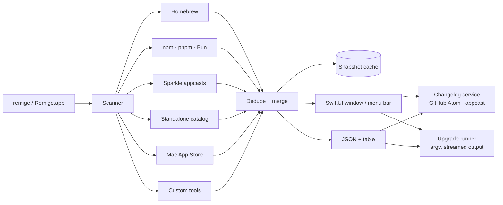

# Remige

[](https://github.com/nichenqin/remige/actions/workflows/ci.yml)

**Every update on your Mac, in one place.**

Remige is a native menu-bar/dock app and a CLI that finds outdated software across the places it actually
lives: Homebrew formulae and casks, global npm/pnpm/Bun packages, Sparkle-updated DMG apps, Mac App Store
apps, and standalone tools installed by `curl`, installers, or tarballs. Read release notes, then update
with one click or one command.

**Website:** [remige.app](https://remige.app/) · **Latest release:** [GitHub Releases](https://github.com/nichenqin/remige/releases/latest)

**中文说明:** [README.zh-CN.md](README.zh-CN.md)

<p align="center">
  
</p>

## Why

Updaters are fragmented. `brew outdated` knows about casks but not global npm packages; `npm outdated -g`
does not know about IINA or DuckDuckGo; Sparkle apps know only themselves. Remige runs those native sources in
parallel, deduplicates the results, caches a snapshot for instant launch, and presents one list with one
upgrade button per row.

## What it finds

| Source | Detection | Upgrade | Release notes |
| --- | --- | --- | --- |
| Homebrew formulae | `brew outdated --json=v2 --greedy` | `brew upgrade --formula` | GitHub releases |
| Homebrew casks (DMG/PKG) | same call | `brew upgrade --cask` | GitHub releases |
| npm global packages | `npm outdated -g --json` | `npm install -g <pkg>@latest` | GitHub releases |
| pnpm global packages | `pnpm list -g` + npm registry | `pnpm add -g <pkg>@latest` | GitHub releases |
| Bun global packages | `~/.bun/install/global` + npm registry | `bun add -g <pkg>@latest` | GitHub releases |
| Sparkle apps | `SUFeedURL` appcasts, channel-aware | opens the full download; cask-managed apps stay with Homebrew | Appcast |
| Other apps | standard Electron Builder `app-update.yml` (GitHub or HTTPS generic manifest) or a verified bundle-id catalog entry (Magpie, Obsidian, Rectangle, Stats, Zed, …) | opens the release or download page | GitHub releases / update manifest |
| Mac App Store | `mas outdated` | `mas upgrade` | App Store page |
| Standalone CLI tools | curated catalog + `--version` + GitHub latest tag | self-update when known, otherwise release page | GitHub releases |
| Your own curl tools | JSON config | any command you specify | GitHub releases |

Apps without a Sparkle feed, Homebrew cask, recognized Electron manifest, or explicit catalog entry are
listed as *unchecked* in the Apps source instead of being guessed. Add an `appUpdates` entry keyed by
bundle identifier in the JSON config for apps with a GitHub repo or latest-version URL.

## Install

**Download:** [Remige-macos.dmg](https://github.com/nichenqin/remige/releases/latest) — universal, macOS 14+.

**One line:**

```sh
curl -fsSL https://remige.app/install.sh | sh
```

**Homebrew:**

```sh
brew tap nichenqin/remige https://github.com/nichenqin/remige
brew install --cask remige-app
brew install remige
```

The installer puts `Remige.app` in Applications (or `~/Applications`) and the `remige` CLI in
`/usr/local/bin` (or `~/.local/bin`), verifies SHA-256, and clears the quarantine flag. Remove it with
`curl ... | sh -s -- --uninstall`.

Public builds are currently ad-hoc signed. Developer ID signing and Apple notarization are wired into the
release workflow but require an Apple Developer Program membership; until then macOS may show a Gatekeeper
prompt on first launch.

### Build from source

```sh
git clone https://github.com/nichenqin/remige.git
cd remige
swift test
make app          # arm64 app in dist/
make install      # ~/Applications/Remige.app + ~/.local/bin/remige
```

Requires macOS 14+ and Swift 6. The app and CLI share `RemigeCore`; there is no daemon or background service.

## CLI

```sh
remige                       # scan and list
remige list --json           # stable machine-readable snapshot
remige list --cached         # instant, last snapshot
remige list --source npm     # one source: homebrew npm pnpm bun app cli mas custom
remige upgrade --all --yes   # run every one-click upgrade
remige upgrade cc-switch --dry-run
remige changelog iina --limit 3
remige open sqlite
remige doctor --json         # paths, managers, cache, config validity
remige cache path|size|clear
remige config path|init|show|edit
remige app                   # open the GUI
remige update --check        # check Remige itself
remige update                # replace the CLI atomically
```

`remige update` checks the release feed and verifies the new binary's SHA-256. Homebrew installations should use
`brew upgrade remige`.
Example:

```text
remige 0.2.0  just now

HOMEBREW
  cc-switch          4.0.14         →  4.0.15  auto
  dataflare          2.6.4          →  3.2.4   auto
  libunistring       1.4.2          →  1.5     auto
...
NPM
  npm                11.20.0        →  12.2.0  auto

22 updates · 19 one-click · scanned in 0.9s
```

`remige upgrade` always shows the exact argv it will run. Without `--yes` it asks once on a TTY and refuses
in scripts. Download-only apps open their release page; they are never installed behind your back.

### JSON

`remige list --json` emits the cached snapshot schema: `generatedAt`, `duration`, `items`, per-source
`reports` (including partial failures and stale cached rows), `host`, and optional `warnings`. Items carry a
stable `id`, `source`, `kind`, versions, repo/changelog metadata, and an `upgrade` plan (`command`,
`openURL`, or `manual`).

## Updating Remige

The app checks `https://remige.app/latest.json`; **Remige → Check for Updates…** shows the sheet.
The update ZIP is verified against the feed's SHA-256, then a small helper waits for Remige to exit, swaps the
app bundle with rollback, and relaunches it. The CLI uses the same feed:

```sh
remige update --check
remige update
```

Homebrew installations should use `brew upgrade remige` and `brew upgrade --cask remige-app`.

## Custom tools

`~/.config/remige/config.json` accepts partial documents. Declare software the catalog does not know:

```json
{
  "customTools": [
    {
      "name": "mytool",
      "path": "/usr/local/bin/mytool",
      "versionArgs": ["--version"],
      "versionRegex": "mytool (\\d+\\.\\d+\\.\\d+)",
      "github": "acme/mytool",
      "upgradeArgs": ["mytool", "self-update"],
      "homepage": "https://acme.dev/mytool"
    }
  ]
}
```

- `versionArgs` and `versionRegex` describe the installed version (capture group 1 wins).
- Use `github: "owner/repo"` or `latestURL` + `latestRegex` for the newest version.
- In `upgradeArgs`, the first element is replaced by the detected executable path; the rest is passed
  through unchanged. Omit it to make the row open the release page instead.
- `disabledSources` can turn off any source, e.g. `["mas", "pnpm"]`.

Apps that ship neither Sparkle nor Electron Builder metadata can be declared by bundle ID:

```json
{
  "appUpdates": [
    {"bundleIdentifier": "com.example.app", "github": "owner/repo"},
    {"bundleIdentifier": "com.example.other", "latestURL": "https://example.com/version", "latestRegex": "v([0-9.]+)"}
  ]
}
```

The source is still never inferred from the app name. Cask-managed apps stay with Homebrew.

## How it works



- **CLI-first core.** The same code powers the app and the CLI; the CLI has no AppKit dependency. This is
  the main lesson taken from [magpie](https://github.com/yetone/magpie): one artifact, multiple surfaces,
  machine-readable output, local-only state.
- **Detectors are independent.** Every source implements `OutdatedSourceDetector`; one failure returns a
  partial result instead of blanking the list. Failed sources can carry the previous cached rows and are
  labeled stale.
- **Everything is bounded.** Each source has a timeout; network work is concurrency-limited; version
  commands have a 3-second budget; caches are TTL'd (15 min appcasts, 6 h latest tags/release notes, 7 days
  Homebrew metadata).
- **No shell interpolation.** Package names become argv elements. The only user-authored commands are
  explicit custom tool configs.
- **Instant paint.** The app loads the last snapshot from disk before scanning, then refreshes in the
  background.

See [docs/ARCHITECTURE.md](docs/ARCHITECTURE.md) for module boundaries, invariants, and failure behavior.

## Performance

Measured on an Apple Silicon Mac (macOS 26.5, 22 updates across 4 sources):

| Metric | Result |
| --- | --- |
| Full scan (in-process) | 0.8–1.3 s warm; up to ~5 s when feeds are cold |
| App / zip / DMG | 7.7 MB / 2.8 MB / 3.2 MB (universal) |
| CLI binary | 4.6 MB (universal) |
| CLI cached list (process startup included) | ≈0.7 s |
| App RSS with 22 rows + release notes | ≈100–140 MB |

No polling, no daemon, no analytics. The menu bar item only refreshes when you open it, press Refresh, or
when the main window becomes stale.

## Tests

```sh
swift test
```

Deterministic tests cover version ordering, Homebrew/npm/JSON fixtures, Sparkle appcasts (channels,
minimum OS, delta vs full enclosures), Electron Builder metadata and manifests, cataloged GitHub apps,
Atom changelogs, update-feed parsing, checksum verification, atomic CLI replacement, app-bundle swap,
config defaults, cache TTL/atomicity, dedupe, argument parsing, process timeouts, streaming upgrades, and
data formatting. Network and process
access are injected through `HTTPGetting` / `CommandRunning`, so the suite makes no live requests. See
[docs/TESTING.md](docs/TESTING.md).

A live smoke test (not part of CI) exercised the complete one-click path against a fake custom tool,
including downloading latest-version metadata and running its upgrade command.

## Security and limits

- No sudo prompts are injected. If `brew` or `mas` needs elevation, the command fails with its own output.
- Sparkle apps without a Homebrew cask open the *full* download; delta enclosures are ignored. Remige does not
  replace app bundles itself.
- Release notes are converted to text before display; scripts and remote images are discarded.
- Homebrew's index is not auto-updated during scans (`HOMEBREW_NO_AUTO_UPDATE=1`). Run `brew update` when you
  want newer formula metadata.
- `mas` support is fixture-tested but depends on a user-installed `mas`; it is skipped otherwise.
- Homebrew metadata comes from `formulae.brew.sh`; private taps without public metadata still list updates,
  but may not have changelogs.

## Credits

Architecture inspired by magpie's single-binary, CLI-first model. Data formats follow the upstream tools:
Homebrew's JSON API, the npm registry, Sparkle appcasts, GitHub's releases Atom feed, and `mas`.

MIT © 2026 nichenqin
