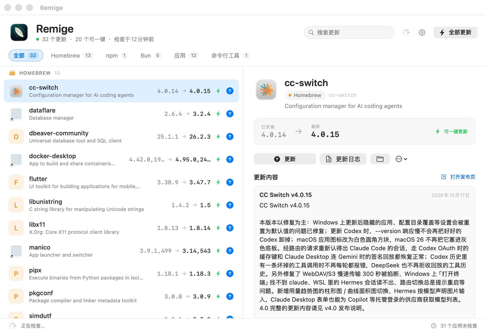
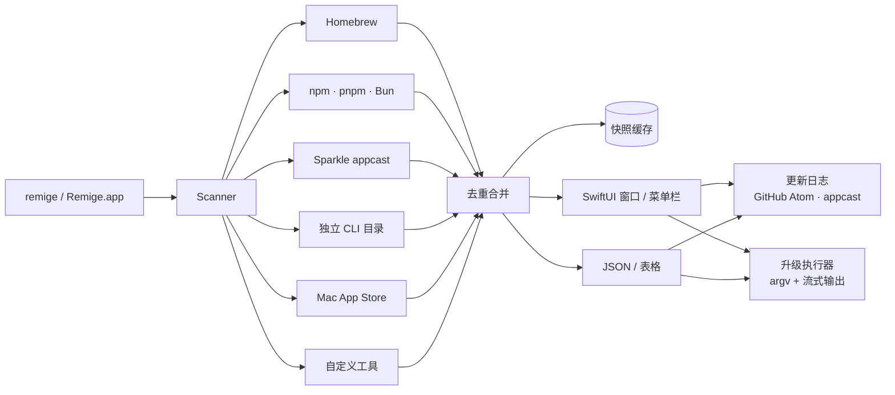

# Remige

[](https://github.com/nichenqin/remige/actions/workflows/ci.yml)

**一个窗口，看全 Mac 上的所有更新。**

Remige 是一个原生菜单栏 / Dock 应用，同时提供 CLI。它会在各个真实来源里并行查找可更新的软件：
Homebrew 的 formula 与 cask、npm / pnpm / Bun 全局包、通过 Sparkle 自更新的 DMG 应用、Mac App Store
应用，以及用 `curl`、安装脚本或压缩包装出来的命令行工具。可以看更新日志，然后一键或一条命令升级。

**官网：** [remige.app](https://remige.app/) · **最新版本：** [GitHub Releases](https://github.com/nichenqin/remige/releases/latest)



## 为什么

更新入口是碎的：`brew outdated` 不知道 npm 全局包，`npm outdated -g` 不知道 IINA 和 DuckDuckGo，
Sparkle 应用只知道自己。Remige 把这些原生数据源并行跑一遍，去重、合并、缓存快照，给你一个列表。

## 覆盖范围

| 来源 | 检测方式 | 升级方式 | 日志 |
| --- | --- | --- | --- |
| Homebrew formula | `brew outdated --json=v2 --greedy` | `brew upgrade --formula` | GitHub Releases |
| Homebrew cask（DMG/PKG） | 同上 | `brew upgrade --cask` | GitHub Releases |
| npm 全局包 | `npm outdated -g --json` | `npm install -g <pkg>@latest` | GitHub Releases |
| pnpm 全局包 | `pnpm list -g` + npm registry | `pnpm add -g <pkg>@latest` | GitHub Releases |
| Bun 全局包 | `~/.bun/install/global` + registry | `bun add -g <pkg>@latest` | GitHub Releases |
| Sparkle 应用 | `Info.plist` 的 `SUFeedURL` | 打开完整下载页；cask 管理的应用由 Homebrew 负责 | Appcast |
| 其他应用 | 标准 Electron Builder `app-update.yml`（GitHub 或 HTTPS generic manifest）或已核实的 bundle id 目录（Magpie、Obsidian、Rectangle、Stats、Zed 等） | 打开发布页或下载页 | GitHub Releases / 更新 manifest |
| Mac App Store | `mas outdated` | `mas upgrade` | App Store |
| 独立 CLI 工具 | 内置目录 + `--version` + GitHub latest | 已知自更新命令，否则发布页 | GitHub Releases |
| 自定义 curl 工具 | JSON 配置 | 你指定的命令 | GitHub Releases |

没有 Sparkle feed、Homebrew cask、可识别的 Electron manifest 或显式目录项的应用不会瞎猜，而是以“未检查”出现在应用来源中。可在 JSON 配置的 `appUpdates` 里按 bundle id 声明 GitHub 仓库或 latest URL。

## 安装

**下载：** [Remige-macos.dmg](https://github.com/nichenqin/remige/releases/latest) — 通用二进制，macOS 14+。

**一行命令：**

```sh
curl -fsSL https://remige.app/install.sh | sh
```

**Homebrew：**

```sh
brew tap nichenqin/remige https://github.com/nichenqin/remige
brew install --cask remige-app
brew install remige
```

安装脚本会校验 SHA-256，把 App 放入 Applications（或 `~/Applications`），CLI 放入 `/usr/local/bin`
（或 `~/.local/bin`），并移除 quarantine。卸载：`curl ... | sh -s -- --uninstall`。

当前公开构建是 ad-hoc 签名。Developer ID 签名和 Apple 公证已接入发布流水线，但需要 Apple Developer
Program 账号；在此之前首次打开可能遇到 Gatekeeper 提示。

从源码构建：

```sh
git clone https://github.com/nichenqin/remige.git
cd remige
swift test
make app
make install
```

要求 macOS 14+、Swift 6。应用和 CLI 共用 `RemigeCore`，没有常驻 daemon。

## CLI

```sh
remige                       # 扫描 + 列表
remige list --json           # 稳定 JSON
remige list --cached         # 立即显示上次快照
remige list --source npm     # homebrew / npm / pnpm / bun / app / cli / mas / custom
remige upgrade --all --yes
remige upgrade cc-switch --dry-run
remige changelog iina
remige doctor --json
remige cache path|size|clear
remige config path|init|show|edit
remige app
remige update --check
remige update
```

`remige upgrade` 会显示将执行的完整 argv。没有 `--yes` 时会在 TTY 上问一次，在脚本里直接拒绝。只提供
下载页的应用不会被静默安装。

## 更新 Remige 本体

应用会检查 `https://remige.app/latest.json`；**Remige → 检查更新…** 打开更新面板。下载的 ZIP
会按 feed 中的 SHA-256 校验，然后由一个小 helper 等待 Remige 退出、带回滚地替换 App 包并重启。CLI 使用
同一个 feed：

```sh
remige update --check
remige update
```

Homebrew 安装请用 `brew upgrade remige` 与 `brew upgrade --cask remige-app`。

## 自定义工具

编辑 `~/.config/remige/config.json`（支持只写需要的字段）：

```json
{
  "customTools": [
    {
      "name": "mytool",
      "path": "/usr/local/bin/mytool",
      "versionArgs": ["--version"],
      "versionRegex": "mytool (\\d+\\.\\d+\\.\\d+)",
      "github": "acme/mytool",
      "upgradeArgs": ["mytool", "self-update"],
      "homepage": "https://acme.dev/mytool"
    }
  ]
}
```

- `versionRegex` 的第 1 个捕获组会被当作版本；不写则用通用版本提取。
- 最新版本来源可以是 `github: "owner/repo"`，或 `latestURL` + `latestRegex`。
- `upgradeArgs` 的第一个元素会被替换为检测到的可执行文件路径，其余原样传入。不写则打开发布页。
- `disabledSources` 可以关闭来源，例如 `["mas", "pnpm"]`。

既没有 Sparkle 也没有 Electron Builder 元数据的应用，可以按 bundle id 声明：

```json
{
  "appUpdates": [
    {"bundleIdentifier": "com.example.app", "github": "owner/repo"},
    {"bundleIdentifier": "com.example.other", "latestURL": "https://example.com/version", "latestRegex": "v([0-9.]+)"}
  ]
}
```

仍然不会按应用显示名称猜测来源；cask 管理的应用继续由 Homebrew 负责。

## 架构



- **CLI 优先的共享核心**：CLI 不依赖 AppKit，应用与 CLI 调同一套 async API。这是从 magpie 学到的
  主要方法论：一个产物、多个界面、机器可读输出、纯本地状态。
- **检测器相互独立**：单个来源失败不会清空其它结果；失败时保留上次缓存并标记 stale。
- **全部有边界**：每个来源有超时，网络并发受限，版本命令 3 秒，缓存有 TTL。
- **不做 shell 拼接**：包名和版本都作为 argv 传递。只有用户显式写的自定义命令可执行。
- **秒开**：应用先读磁盘快照，再后台刷新。

详细设计见 [docs/ARCHITECTURE.md](docs/ARCHITECTURE.md)。

## 性能

在 Apple Silicon / macOS 26.5 上实测（22 个更新，4 个来源）：

| 指标 | 结果 |
| --- | --- |
| 完整扫描（进程内） | 热缓存 0.8–1.3 秒；冷启动含网络最长约 5 秒 |
| App / zip / DMG | 7.7 MB / 2.8 MB / 3.2 MB（通用二进制） |
| CLI | 4.6 MB（通用二进制） |
| CLI `--cached`（含进程启动） | ≈0.7 秒 |
| App 内存（22 行 + 更新日志） | ≈100–140 MB |

没有轮询、没有 daemon、没有遥测。菜单栏只在打开、手动刷新或主窗口过期时扫描。

## 限制与安全

- 当前公开构建是 ad-hoc 签名。Developer ID 签名 / 公证已接入 release workflow，但需要 Apple Developer Program 账号。
- 不会注入 sudo。brew / mas 需要提权时，会原样返回其错误。
- 非 cask 管理的 Sparkle 应用只打开完整下载（忽略 delta 包），Remige 不替换应用包。
- 更新日志在展示前转成纯文本，脚本和远程图片被丢弃。
- 扫描时设置 `HOMEBREW_NO_AUTO_UPDATE=1`；需要最新 formula 元数据时自己跑 `brew update`。
- `mas` 需要用户自己安装；没有就跳过。
- 私有 tap 没有公开元数据时仍能列更新，但可能没有日志。

## 测试

```sh
swift test
```

71 个确定性测试，覆盖版本比较、Homebrew/npm 夹具、Sparkle 频道与 delta/full、目录内 GitHub 应用、
Atom 日志、更新 feed、SHA-256 校验、CLI 原子替换、App bundle 替换、配置默认值、缓存 TTL/原子写、去重、
参数解析、进程超时、流式升级和输出格式。网络和进程均通过协议注入，测试不访问外网。详见
[docs/TESTING.md](docs/TESTING.md)。

## 许可

MIT © 2026 nichenqin
